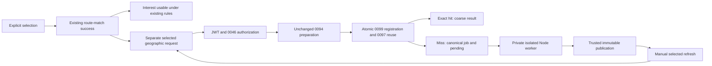

# 0100 requester selected geographic-support integration

Baseline `1d141a6 feat(matching): add private shared-segment assessment worker
foundation`, branch `feature/0092-shared-segment-suitability`. Local implementation
only; production remains verified through 0091. No host selection or deployment.

## Architecture and authority

`checkOfferedMovement` in the requester screen completes the unchanged selected
`calculate-route-match` flow first. It publishes the six-field route-match result
and selected binding, then starts a separate geographic request without awaiting
it or retaining the global `busy` state. Interest continues to use exactly its
existing route-match evidence, expiry and interest-write rules.



`prepare-requester-geographic-support` authenticates a real JWT/member, accepts
only `movementNeedId` and `availabilityId`, and authorizes ownership/current need
and the exact selected availability through 0046's
`get_requester_availability_matching_context_for_server` before provider work.
It delegates preparation to the unchanged
`createRequesterRouteGenerationHandler` as an in-process operation with a new
need-only Request and the same JWT and cancellation signal. This deliberately
retains 0094's additional authentication/current-need checks. It makes no network
request to another Edge endpoint and duplicates no claim, quota, provider,
publication, timeout or lost-response recovery logic.

After readiness, selection is revalidated, then the service-only existing 0099
`register_requester_availability_assessment_job_for_server` runs. That transaction
already validates the exact selection, invokes 0097's
`get_current_shared_segment_geographic_assessment_for_server` before insertion,
deduplicates the canonical job and revalidates selection before returning. This
is the needed atomic selected reuse/status boundary. **No 0100 migration, table,
new RPC or historical migration change is necessary.** All 0099 attempt/fencing
and terminal-state protections remain unchanged.

There is no cold assessment computation in Edge, no geometry engine import in
its entire production dependency graph, and no local get-or-produce invocation.
Only the isolated private Node worker owns cold 0096 computation/publication.
The public handler never claims, loads, finalizes or fails a worker job.

## Public contract and state mapping

Authenticated POST body, with no query or additional/private selectors:

```json
{"movementNeedId":"uuid","availabilityId":"uuid"}
```

The only response fields are `geographicSupport` and an optional
`retryAfterSeconds`. The latter is accepted only for pending, as an integer from
1 through 30, and currently comes only from validated 0094 generation-in-progress
metadata. Job pending has no invented retry hint or completion SLA.

| Internal result | Public geographicSupport |
| --- | --- |
| 0094 generated or reuse_existing | continue selected revalidation/registration |
| 0094 in_progress | pending; bounded generation retry hint |
| 0094 provider/runtime/quota/unsupported failure | unavailable |
| Exact complete geometric_corridor_support | geometric_corridor_support |
| Exact complete overlap_observed | overlap_observed |
| Exact complete inconclusive | inconclusive |
| Exact persisted processing_limit | unavailable, with zero new jobs/compute |
| Pending/running canonical job | pending |
| Completed job racing registration | one additional selected exact lookup; completed result or unavailable |
| Failed/stale/expired/not_ready or safety/transport failure | unavailable |

No failure, missing evidence, pending work, processing limit or infrastructure
termination becomes inconclusive. A terminal canonical job is never reset by a
participant retry. A completed row must still have an exact current assessment.
The completed-race retrieval is bounded to one extra registration/lookup call.

Unauthorized, malformed, unsupported or unavailable requests have the same coarse
unavailable body with suitable HTTP status (401/403/400/404/413/415/503 as applicable).
Ordinary readiness or provider failures may return a 200 unavailable annotation.
No private member/intent/evidence/assessment/job ID, lease, attempt count, geometry,
coordinates, provider reference, fingerprint or algorithm version is returned.
Responses are private/no-store, reject redirects in trusted transports and use
generic errors. Body reads are bounded to 2 KiB; app responses to 1 KiB.

The new config stanza enables only this JWT-protected endpoint. The control path
has a 30-second wall budget and five-second bootstrap budget. Delegated 0094 keeps
its unchanged 20-second overall, five-second provider and bounded publication/
recovery budgets. The app bounds the request to 35 seconds. These are control I/O
budgets, not a worker-completion promise or an Edge CPU workaround.

## Requester UI and client

The strict app service snapshots the two validated public selectors before any
asynchronous session work, validates exact response keys/states/hints, propagates
cancellation, bounds body size and exposes generic errors only.

Only the selected card's existing route-result detail gains a neutral line:

- Support: “Reference routes show continuous geometric support.”
- Overlap: “Some geometric overlap was observed.”
- Inconclusive: “This reference-route comparison is inconclusive. Other routes remain unassessed.”
- Pending: “Checking the selected reference routes…”
- Unavailable: “Reference-route comparison is unavailable.”

No compatibility, road identity, eligibility, admission or recommendation claim
is added. Frozen results retain all three authority/topology flags false.

State is keyed by the exact need/availability pair and guarded by the current
operation object. Selection changes, declaration edits and unmount abort and
discard earlier responses, including transports that complete after cancellation.
A synchronous route-selection guard prevents repeated same-render taps; a separate
geographic in-flight guard prevents duplicate refreshes. Neither changes interest
eligibility. All five geographic states leave the existing interest action usable
when its route-match rules permit it.

There is **no automatic polling**. Pending/unavailable selections expose one manual
“Refresh reference-route comparison” action after the current request ends. Each
press starts at most one exact public request; it cannot restart a terminal job or
force generation. An inactive worker leaves a valid job pending while interest
continues to work. Browsing fifty candidates performs no selected geographic call,
requester generation or job registration. Offerer browsing/inbox/action has no new
requester-provider/job path; its source and services are unchanged.

## Verification

All providers are mocks. SQL uses schema-only disposable local
clones, with before/after original data/catalog/ACL/RLS/history fingerprints. The
new SQL-backed harness exercises the actual 0046, 0094 and 0099 boundaries and real
local HTTP around the shipped handler; its auth/provider network responses are
mocked. No SQL transaction remains open across provider work.
The SQL-backed HTTP adapter pools an autocommit connection rather than spawning
docker/psql for each RPC, and explicitly checks there is no idle transaction during
mocked provider execution. Fixed production handler deadlines are unchanged. The
need-expiry fixture sets a legitimate future departure and waits for natural expiry;
it does not bypass the planning-horizon trigger or edit a departure into the past.

The historical 0090 requester-screen blob and 0091 client baseline remain pinned.
Only twelve exact, reviewable 0100 source chunks are removed before applying those
unchanged pins. All other previously protected sources remain byte-identical.
The 0099 no-participant-endpoint assertion now checks that its own migration has no
0100 endpoint addition; the new endpoint separately has a transitive no-geometry
source guard. No historical SQL assertion or migration hash was weakened.

Fresh reset through 0100 is not applicable because no migration was added. The
effective schema remains 0099; every SQL clone installs and verifies that complete
source/security boundary. App, Edge and worker typechecks cover the new endpoint
and leave the worker implementation unchanged.

| Verification | Result |
| --- | --- |
| 0100 Edge/orchestration/source guards | 48 passed |
| 0100 app service | 26 passed |
| New requester UI behavior/races | 13 passed; final targeted browsing/offerer/service/UI rerun 41 passed |
| Actual SQL-backed endpoint / real local HTTP | 16 passed, including one-provider lost-COMMIT recovery, canonical deduplication, natural need expiry and terminal stale-job retry |
| 0099 worker/runtime Node | 38 passed in full Supabase suite |
| 0099 SQL security / worker behavior / concurrency | 8 / 49 / 10 passed; concurrency zero deadlocks |
| 0098 route-match SQL/HTTP / concurrency | 27 / 6 passed; concurrency zero deadlocks; six-field response unchanged |
| 0096 / 0097 behavior | 34 / 16 passed |
| 0096 / 0097 SQL security | 8 / 6 passed |
| 0096 / 0097 concurrency | 12 / 3 passed; zero deadlocks |
| 0092 / 0093 / 0094 / 0095 SQL | 24 / 49 / 26 / 13 passed |
| 0093 / 0094 / 0095 concurrency | 16 / 9 / 7 passed |
| 0046 selected / 0047 interest / 0049 continuation / 0052 deadline | 26 / 70 / 52 / 25 passed |
| 0031 / 0032 / 0033 / 0037 / 0038 route support SQL | 15 / 56 / 29 / 25 / 16 passed |
| 0089 priority behavior / concurrency | 75 assertions / 8 scenarios, 19 reads, one blocking and three lock-release proofs passed; zero deadlocks |
| 0089 legacy compatibility | 86 inbox, 52 continuation, 34 reputation and 203 legacy assertions passed |
| 0090 priority behavior / concurrency | 89 assertions / 11 scenarios with six actual blocking and six lock-release proofs passed; zero deadlocks |
| 0091 roster behavior | 99 assertions passed |
| 0091 roster concurrency / temporal | 22 scenarios with 18 actual blocking and six continuation proofs / 17 checks passed; zero deadlocks |
| Full Supabase Node | 68 files; 1,279 passed, zero failures/skips |
| Full root Node | 48 files; 997 tests: 996 passed, zero failures, one existing optional DuckDB skip |
| App / Edge / worker typechecks | All passed |
| New validation harness syntax | Passed |
| Original historical requester-screen pin guards | 27 focused checks passed, with original baseline/blob values retained |
| Installed source / security | Exact 0093/0094/0095/0096/0097/0098/0099 boundaries, effective 0082/0046 writers, priority/roster bodies, owners, empty search paths, role ACLs and private RLS/no policies verified |
| Historical integrity | All 99 migration sources match HEAD; 0094 operation, 0096 engine/parameters, 0099 worker and prior services unchanged |
| Config scope | Exactly one new authenticated endpoint stanza; remainder equals HEAD |
| Fingerprints | Original application data/catalog/ACL/RLS/history unchanged before/after every disposable run |
| Fresh reset through 0100 | Not applicable: no migration added; schema remains 0099 |
| `git diff --check` | Passed |
| Disposable cleanup / staging | Zero remaining `requester0093_<12 hex>` databases; index empty; HEAD remains `1d141a6` |

Frozen SHA-256: geometry
`d48f53b5f7e2e226ed9a1c23d9dd1884e6a6350539e8e58b794061103db54043`;
parameters/contracts
`9ad2c9a1675a4caeb4a6d658bcb8b24fcaecc6ae1b101effea906b8e216eda95`.

## Cost and activation gate

NEW VENDOR: **NONE in this milestone**. No external queue was installed.

REQUIRED: existing Mapbox requester route generation when no current route exists;
existing private DB jobs/indexes and retained history; DB/Edge control requests;
worker compute hosting before production activation. First selected preparation
admits at most one provider attempt; repetitions and another candidate for the
same current need reuse its requester route.

STRONGLY RECOMMENDED: worker queue depth, pending duration and execution metrics;
selected endpoint rate limits; target-host benchmarks including trusted I/O,
publication/recovery reserve and worker lease/memory/CPU behavior.

OPTIONAL: richer visual support, background warming, offerer annotation, external
queue and autoscaling. No paid host was chosen. Production worker-host cost remains
unresolved, and annotation is not declared launch-ready. Production activation
requires host selection and target-host benchmarks. Offerer geographic integration
and all admission work remain deferred.

Nothing staged, committed, pushed or deployed. No production access and no real
Mapbox or other provider request. Frozen 0096 algorithm/parameters and all 99
historical migrations remain unchanged.

## Changed-file manifest

Modified (8):

- `docs/MOVEMENT_SYSTEM_SPEC.md`
- `docs/MOVEMENT_LAUNCH_READINESS_REGISTER.md`
- `src/app/request-movement.tsx`
- `supabase/config.toml` (new endpoint stanza only)
- `supabase/tests/0099_shared_segment_assessment_job_foundation.test.cjs` (historical milestone guard only)
- `tests/requesterMovementInterest.test.cjs` (geographic mock and behavior/race proofs)
- `tests/preDepartureRosterFreeze.test.cjs` (exact sanctioned delta before original baseline comparison)
- `tests/trustedRequesterMovementPriority.test.cjs` (same original blob pins)

Created (11):

- `docs/0100-requester-geographic-support-integration.md`
- `src/services/requesterGeographicSupportService.ts`
- `supabase/functions/_shared/requester-geographic-support-contracts.ts`
- `supabase/functions/_shared/requester-geographic-support-runtime.ts`
- `supabase/functions/_shared/requester-geographic-support-orchestration.ts`
- `supabase/functions/prepare-requester-geographic-support/index.ts`
- `supabase/tests/0100_requester_geographic_support.test.cjs`
- `supabase/tests/0100_requester_geographic_support_harness.cjs`
- `supabase/tests/0100_requester_geographic_support_validation.cjs`
- `tests/requesterGeographicSupportService.test.cjs`
- `tests/support/requesterGeographicSupportDelta.cjs`

Exact `git status --short` (the endpoint directory is expanded in the manifest):

```text
 M docs/MOVEMENT_LAUNCH_READINESS_REGISTER.md
 M docs/MOVEMENT_SYSTEM_SPEC.md
 M src/app/request-movement.tsx
 M supabase/config.toml
 M supabase/tests/0099_shared_segment_assessment_job_foundation.test.cjs
 M tests/preDepartureRosterFreeze.test.cjs
 M tests/requesterMovementInterest.test.cjs
 M tests/trustedRequesterMovementPriority.test.cjs
?? docs/0100-requester-geographic-support-integration.md
?? src/services/requesterGeographicSupportService.ts
?? supabase/functions/_shared/requester-geographic-support-contracts.ts
?? supabase/functions/_shared/requester-geographic-support-orchestration.ts
?? supabase/functions/_shared/requester-geographic-support-runtime.ts
?? supabase/functions/prepare-requester-geographic-support/
?? supabase/tests/0100_requester_geographic_support.test.cjs
?? supabase/tests/0100_requester_geographic_support_harness.cjs
?? supabase/tests/0100_requester_geographic_support_validation.cjs
?? tests/requesterGeographicSupportService.test.cjs
?? tests/support/requesterGeographicSupportDelta.cjs
```
